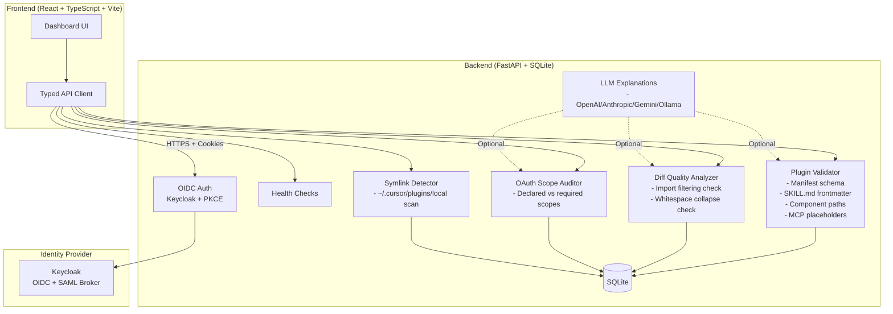

# Axiom Pilot — Ryan Vo | AI & Machine Learning

> Work in progress. This checkpoint may be incomplete or fail tests. See PLAN.md and STATUS.md before use.


**Axiom Pilot** is an AI/ML developer tool for analyzing and validating Cursor plugin quality. It addresses real pain points from the Cursor plugin ecosystem: broken plugin loading via symlinks, diff rendering bugs that misnumber lines, OAuth scope mismatches that break connector authentication, and incomplete CI validation that lets invalid manifests slip through.

Built for AI/ML engineers who build developer tools and agent workflows, Axiom Pilot provides a deterministic offline core with optional LLM-powered explanations for validation findings.

---

## Architecture



---

## Features

### 1. Plugin Manifest Validator
Validates Cursor plugin manifests comprehensively:
- `plugin.json` against JSON schema
- `SKILL.md` frontmatter parsing (YAML, required `name`/`description`)
- Existence of `agents/`, `skills/`, `hooks/`, `mcp.json`, `logo` paths
- `mcp.json` `${VAR}` placeholders declared in `variables`
- Detection of plugin directories not listed in marketplace

### 2. Diff Quality Analyzer (Issue #472)
Detects bugs in PR review diff renderers:
- **Import filtering before line numbering**: Import lines removed before `@@` header counters reset, causing subsequent lines to be numbered incorrectly
- **Whitespace-only collapsing**: `replace(/\s/g, '')` strips all whitespace, hiding meaningful changes like `"a b"` → `"ab"` or Python indentation changes
- Reports exact line references from original hunk headers

### 3. OAuth Scope Auditor (Issue #385)
Audits declared OAuth scopes against required API scopes:
- Checks connector scopes vs API requirements (e.g., Gmail `gmail.settings.basic` for filters)
- Generates remediation report with missing scopes
- Documents re-consent requirements for existing users

### 4. Symlink Detector (Issue #35)
Scans `~/.cursor/plugins/local` for symlinked plugins that won't load:
- Reports symlinked plugins with generic "Imported" label
- Suggests copy-based workflow as workaround

### 5. Opt-in LLM Explanations
Optional AI-powered explanations for validation findings:
- Supports OpenAI-compatible, Anthropic, Gemini, Ollama via httpx adapters
- Explanations labeled **advisory**, grounded in actual records
- Clear provider errors, never fabricates successful responses
- Works fully without LLM key (deterministic core)

---

## Quick Start

### Prerequisites
- Docker 24+ and Docker Compose v2
- Node 24+ (for local frontend dev)
- Python 3.12+ (for local backend dev)

### Using Docker Compose (Recommended)

```bash
# Clone and enter directory
cd axiom-pilot-ryan-vo

# Copy environment template
cp .env.example .env

# Start all services (Keycloak, Backend, Frontend)
docker compose up --build

# Access:
# Frontend:  http://127.0.0.1:5173
# Backend:   http://127.0.0.1:8000
# API Docs:  http://127.0.0.1:8000/docs
# Keycloak:  http://127.0.0.1:8080 (admin/admin)
```

### Local Development

**Backend:**
```bash
cd backend
python3 -m venv .venv
source .venv/bin/activate
pip install -r requirements.txt
cp ../.env.example .env
# Edit .env with your settings
uvicorn app.main:app --reload --host 127.0.0.1 --port 8000
```

**Frontend:**
```bash
cd frontend
npm install
npm run dev
# Runs at http://127.0.0.1:5173 with proxy to backend
```

---

## Configuration

### Environment Variables

| Variable | Required | Default | Description |
|----------|----------|---------|-------------|
| `SECRET_KEY` | Yes (prod) | — | JWT/session signing key (32+ chars) |
| `OIDC_CLIENT_SECRET` | Yes (prod) | — | Keycloak client secret |
| `DATABASE_URL` | No | `sqlite+aiosqlite:///./data/app.db` | SQLAlchemy async URL |
| `OIDC_ISSUER_URL` | No | `http://127.0.0.1:8080/realms/axiom-pilot` | Keycloak realm URL |
| `OIDC_REDIRECT_URI` | No | `http://127.0.0.1:8000/auth/callback` | Backend callback endpoint |
| `FRONTEND_URL` | No | `http://127.0.0.1:5173` | Frontend origin for CORS |
| `LLM_API_KEY` | No | — | LLM provider API key (optional) |
| `LLM_PROVIDER` | No | `openai-compatible` | `openai-compatible`, `anthropic`, `gemini`, `ollama` |
| `LLM_MODEL` | No | `gpt-4o-mini` | Model name |
| `LLM_BASE_URL` | No | — | Custom base URL (e.g., Ollama, LiteLLM) |
| `DEMO_MODE` | No | `false` | Localhost-only demo (refused in production) |

### Keycloak Setup

The included `keycloak/realm-export.json` configures:
- Realm: `axiom-pilot`
- Client: `axiom-pilot` (confidential, PKCE enabled)
- Roles: `viewer`, `operator`, `admin` (composite)
- Users: `demo`/`demo` (viewer+operator), `admin`/`admin` (admin)
- Scopes: `openid`, `profile`, `email`, `roles`

For SAML IdP brokering, add an Identity Provider in Keycloak admin console:
1. Identity Providers → Add Provider → SAML v2.0
2. Configure IdP metadata/URL
3. Map SAML attributes to Keycloak user attributes
4. Enable "Sync Mode" for automatic user provisioning

---

## API Reference

### Health
- `GET /healthz` — Basic health check
- `GET /healthz/ready` — Readiness with database connectivity

### Authentication (OIDC Authorization Code + PKCE)
- `GET /auth/login?redirect_after=/path` — Initiate login
- `GET /auth/callback` — OIDC callback (sets HttpOnly session cookie)
- `POST /auth/logout` — Clear session, return OIDC logout URL
- `GET /auth/me` — Current user (requires session cookie)
- `POST /auth/csrf` — Get CSRF token (sets cookie, returns token)

### Authorization
All data endpoints require authentication via HttpOnly SameSite cookie.
Roles: `viewer` (read), `operator` (write), `admin` (all).
CSRF protection via `X-CSRF-Token` header on state-changing requests.

---

## Testing

### Backend
```bash
cd backend
source .venv/bin/activate
PYTHONPATH=. pytest tests/ -v
```

### Frontend
```bash
cd frontend
npm test
```

### Full CI (matches GitHub Actions)
```bash
# Backend
cd backend && PYTHONPATH=. pytest tests/ -v

# Frontend
cd frontend && npm ci && npm run build && npm test

# Docker builds
docker build -t axiom-pilot-backend ./backend
docker build -t axiom-pilot-frontend ./frontend
```

---

## Security Limitations

- **Demo mode**: Enabled via `DEMO_MODE=true` (localhost only). Startup **refuses** demo mode if `ENVIRONMENT=production`.
- **Secrets**: Never committed. Use `.env` (gitignored) or Docker secrets in production.
- **Tokens**: Access/refresh tokens never persisted in localStorage. Session in HttpOnly cookie, PKCE verifier in sessionStorage.
- **HTTPS**: Required in production. Use TLS reverse proxy (Traefik, nginx, Caddy) in front of compose.
- **Keycloak**: Change default `admin`/`changeme` credentials before exposing.
- **CORS**: Restricted to `FRONTEND_URL` only.

---

## Backup & Restore

**SQLite (development):**
```bash
# Backup
cp backend/data/app.db backup/app-$(date +%F).db

# Restore
cp backup/app-2025-01-15.db backend/data/app.db
```

**PostgreSQL (production profile):**
```bash
# Backup
docker exec axiom-pilot-db pg_dump -U axiom_pilot axiom_pilot > backup.sql

# Restore
docker exec -i axiom-pilot-db psql -U axiom_pilot axiom_pilot < backup.sql
```

**Keycloak:** Export realm from admin console or use `kc.sh export`.

---

## AI/ML Evaluation

This tool implements deterministic algorithms for plugin quality analysis. No LLM is required for core functionality.

**Reproducible validation commands (when implemented):**
```bash
# Plugin manifest validation
python -m validator /path/to/plugin --schema schemas/plugin.schema.json

# Diff quality analysis
python -m diff_analyzer --diff-file pr.diff --check-imports --check-whitespace

# OAuth scope audit
python -m oauth_auditor --connector gmail --scopes-file gmail_scopes.json
```

**Baseline metrics (to be measured):**
- Manifest validation: 100% schema compliance detection on Cursor plugins corpus
- Diff analyzer: Detects import-filtering and whitespace-collapsing bugs with 0 false positives on test corpus
- OAuth auditor: Identifies missing scopes for top 10 MCP connectors

**Failure cases:**
- Heuristic-based import detection may miss non-standard import syntax
- Whitespace analysis limited to leading/trailing trim for whitespace-sensitive languages
- OAuth scope mapping requires manual maintenance per connector API

---

## License

MIT License — Copyright (c) 2025 Ryan Vo <ryandtvo@gmail.com>

---

## Changelog

See [CHANGELOG.md](CHANGELOG.md) for version history.